<!--- Github page main file --->

Gittyup is a graphical Git client designed to help you understand and manage your source code history. Gittyup is an open source software developed by volunteers, if you like the application please support us [](https://liberapay.com/Gittyup/donate)

Stable versions for different packages are available for
- Flatpak for Linux [](https://flathub.org/apps/details/com.github.Murmele.Gittyup)
- [32 / 64 binary for Windows](https://github.com/Murmele/Gittyup/releases/latest) or
- [macOS](https://github.com/Murmele/Gittyup/releases/latest) or from [](https://formulae.brew.sh/cask/gittyup)

The [latest development version](https://github.com/Murmele/Gittyup/releases/tag/development) is available either as pre-built for
- flatpak for Linux,
- 32 / 64 binary for Windows,
- macOS

or, can be built from source by following the directions in the [Gittyup Repository](https://github.com/Murmele/Gittyup#how-to-build).

To see the changes of the current version please have a look at the <A href="#changelog">changelog</A> section

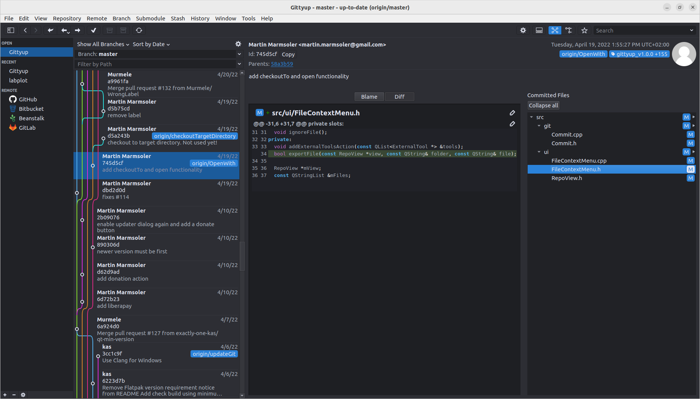

How to Get Help
===============

Ask questions about building or using Gittyup on
[Stack Overflow](http://stackoverflow.com/questions/tagged/gittyup) by
including the `gittyup` tag. Remember to search for existing questions
before creating a new one.

Report bugs in Gittyup by opening an issue in the
[issue tracker](https://github.com/Murmele/gittyup/issues).
Remember to search for existing issues before creating a new one.

If you still need help, check out our Matrix channel
[Gittyup:matrix.org](https://matrix.to/#/#Gittyup:matrix.org).

Multi language support
======================

Gittyup supports the following languages:
- English (en)
- German (de)
- Spanisch (es)
- Japanese (ja)
- Portuguese (pt)
- Portuguese Brazil (pt_BR)
- Chinese (zh_CN)
- Russian (ru)

By default the system language is used. To switch to another language execute the application with the following command
```
LANG=<lang> <executable>
```


Features
========

### Single branch view to focus on your work
Select "Show Selected Branch" in the drop down menu above the commit list
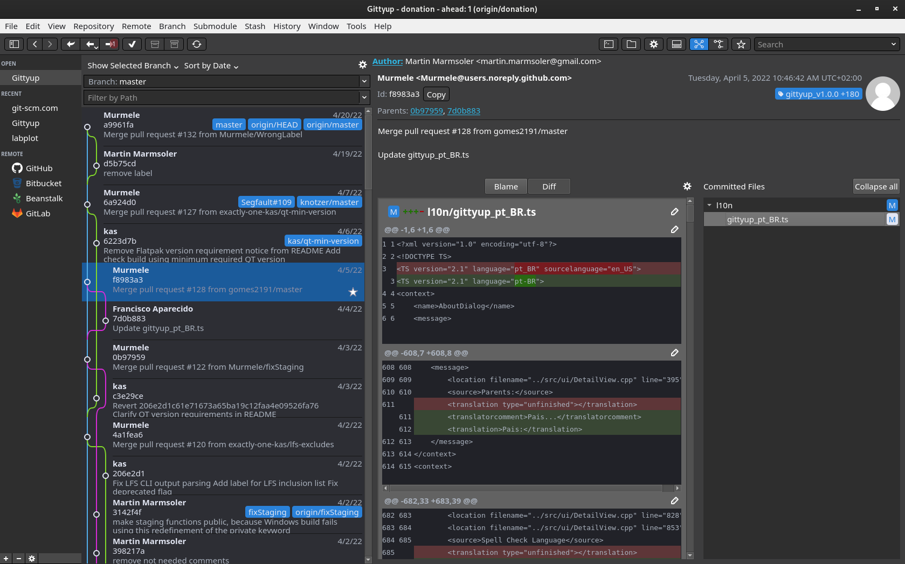

### Reference visibility

Hide ref names without changing the commit history:

1. Open **Tools > Options... > References** for global rules, or
   **Repository > Configure Repository... > References** for a repository.
2. For repository-specific rules, clear **Use global settings**. The repository
   rule list replaces the global list; it does not append to it.
3. Check refs in the searchable checklist to hide individual names, or edit the
   rule list (one rule per line). The global checklist uses refs from open
   repositories to preview the global rules, even if a repository has overrides.
4. Click **Apply** to save and refresh the affected views.

Rules match full, case-sensitive ref names:

| Rule | Effect |
|------|--------|
| `refs/heads/topic` | Hide one local branch name |
| `refs/remotes/origin/archive/*` | Hide matching remote-tracking branch names |
| `refs/tags/old-*` | Hide matching tag names |
| `refs/agents/*` | Hide agent refs (the built-in default) |

`*` matches any text, including `/`; `?` matches one character. Matching covers
the whole name, and all other characters are literal (no regular expressions,
character classes, or negation). A ref matched by a wildcard is checked and
disabled in the checklist: edit or remove that rule to reveal it.

**Show All**, then **Apply**, saves an empty rule list. An empty repository
override stays empty even if global defaults change. **Inherit Global Settings**
removes the repository override; **Reset Defaults** in global options restores
the built-in `refs/agents/*` exclusion.

Exclusions affect the navigation selector, commit badges, and commit-detail ref
labels, including tag descriptions. They never delete refs, prune history roots,
or restrict checkout, merge, push, or other Git-operation dialogs. Commits reachable
only through hidden refs still appear in the all-branches history. The current
checkout (including detached HEAD) and stash remain visible. If an already selected
ref is hidden, the selected-branch history stays in place and its header becomes
**(Hidden reference)** instead of switching to HEAD.

Rules are stored in Gittyup's application configuration, not Git's own settings.
The global key is `refs.hidden` in the application-data `config` file; the
repository override is in `gittyup/config` under the repository's Git directory
(normally `.git/gittyup/config`). For example:

```ini
[refs]
    hidden = "refs/agents/*\nrefs/remotes/origin/archive/*"
```

An explicit `hidden = ""` means show all; an absent key inherits global rules,
or the built-in default when no global key exists. Prefer the UI for editing so
open views refresh immediately.

### Fullscreen
of the history or the change dialog by pressing Ctrl+M

### Tabs
to be able to switch fast between repositories

### Diff View
Staging and unstaging changes, viewing Blame
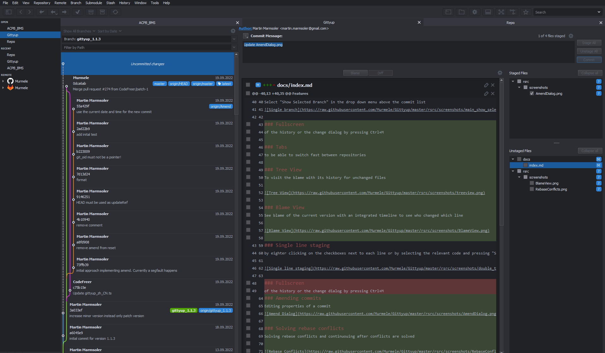

### Tree View
To visit the blame with its history for unchanged files

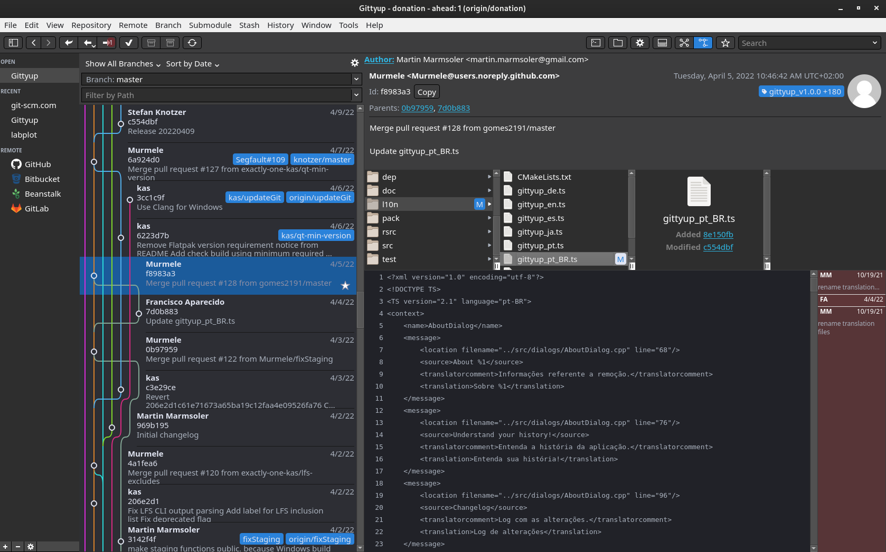

### Blame View
See blame of the current version with an integrated timeline to see who changed which line

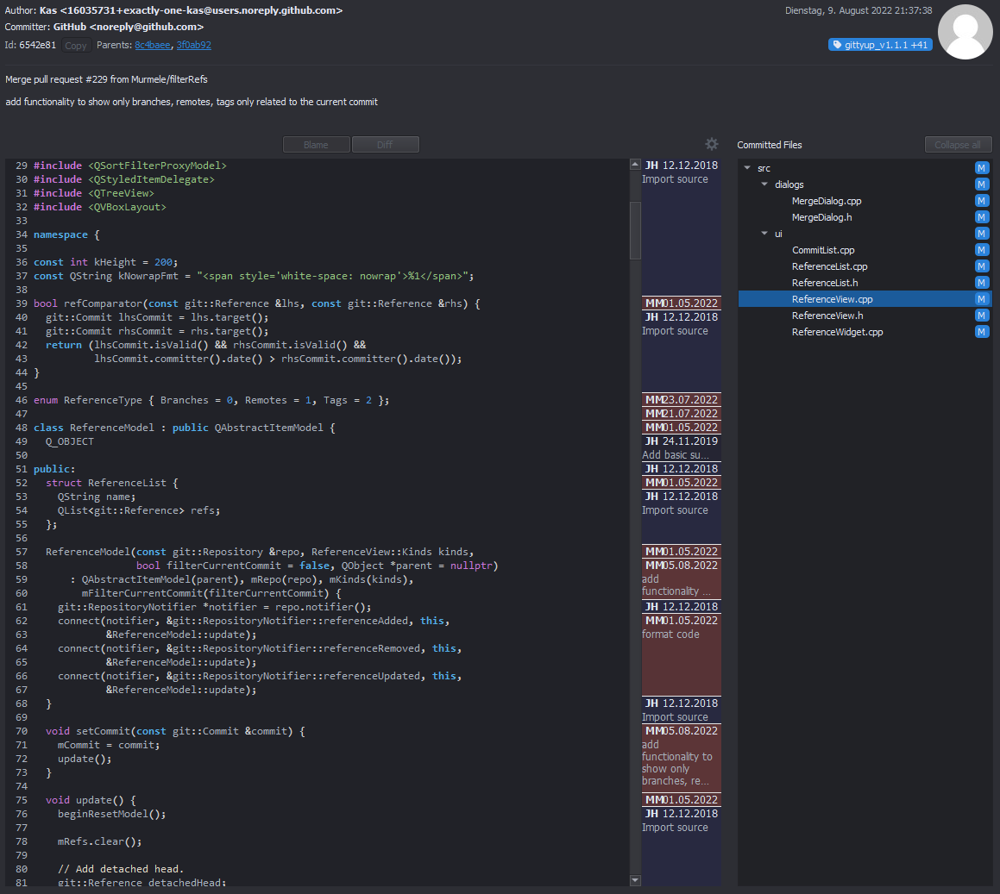

### Dynamic Line Wrapping
Courtesy of Scintilla.

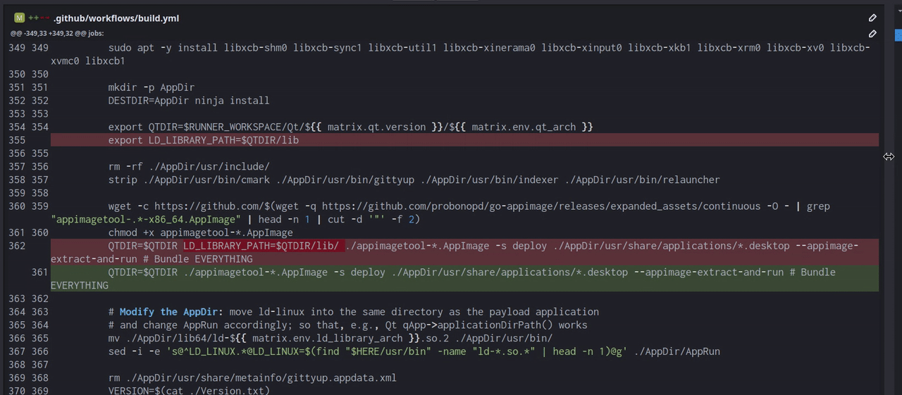

### Single line staging 
by eighter clicking on the checkboxes next to each line or by selecting the relevant code and pressing "S". For unstaging you can uncheck the checkboxes or press "U". To revert changes, select the text and press "R".

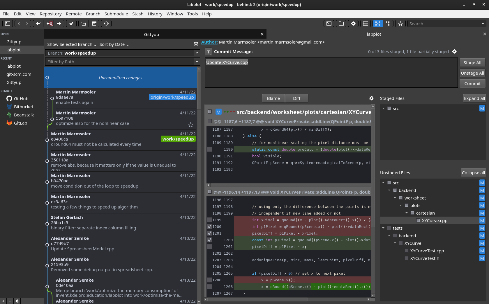

### Amending commits
Editing properties of a commit
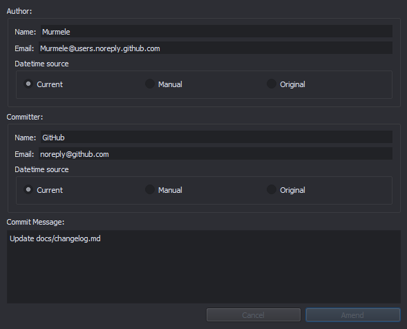

### Solving rebase conflicts
Solving rebase conflicts and continuing after conflicts are solved

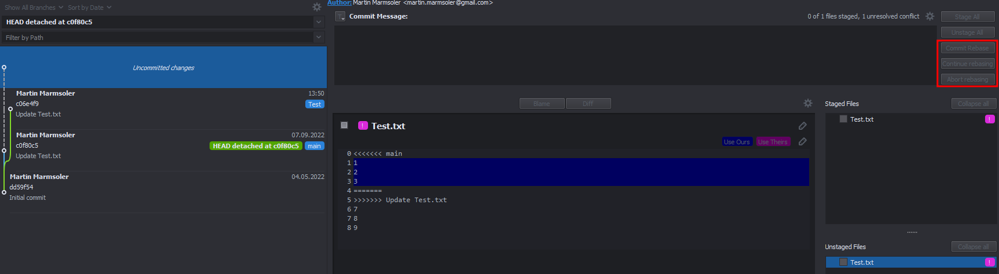

### Starring commits
to find specific commits much faster
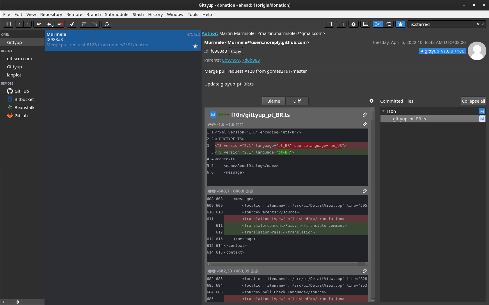

### Tag selection
Use an existing tag as template for your next tag. So you never have to look which is your latest tag

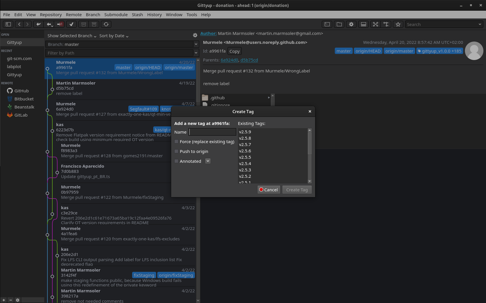

### Commit message template
Create you commit messages according a defined template. The first template is automatically applied to the commit message editor.

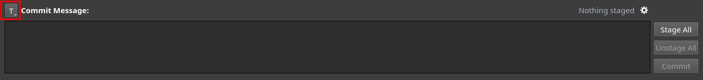

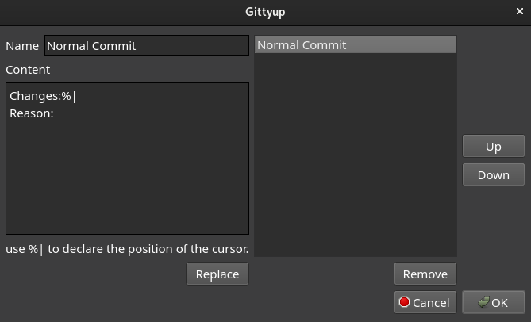

### And a lot more ...

Changelog
=========


